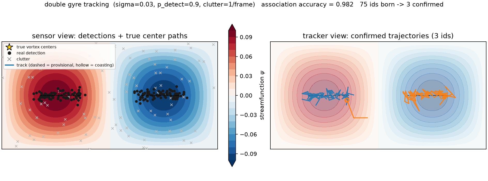
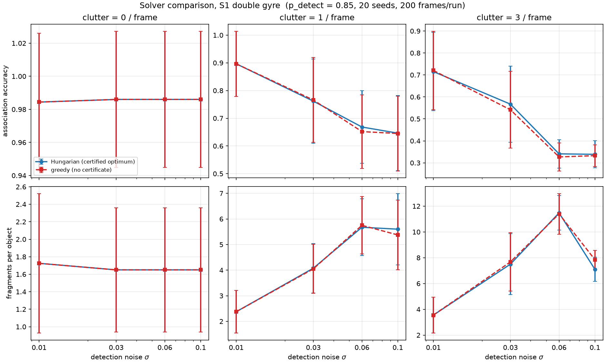
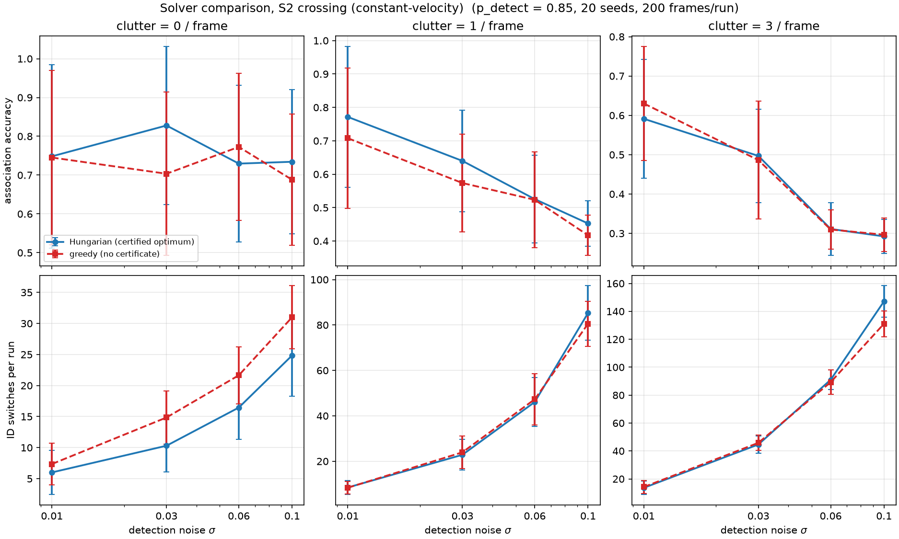
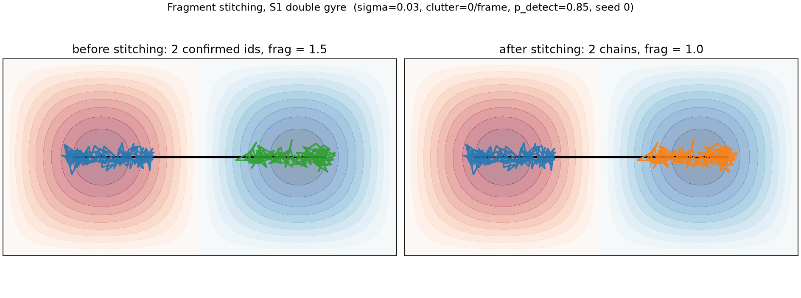

# gyre-tracking

Eddy tracking on an analytic **double-gyre** flow, built around a per-frame
**linear assignment** core whose output carries a *verified optimality
certificate*: the solver returns dual potentials, and three O(n²) checks
(dual feasibility, complementary slackness, strong duality) prove each
frame's matching optimal. **Trust the certificate, not the implementation.**

## What it looks like



Left: the sensor view — detections (dark dots), clutter (gray ×) and the
closed-form vortex-center paths (gold stars). Right: the tracker view —
certified per-frame assignments assembled into trajectories.

## Results in one table

Hungarian, p_detect = 0.85, 20 seeds, 200 frames (full sweep: 2880 runs):

| condition | assoc | frag / object | after stitching |
|---|---|---|---|
| clutter = 0 | **0.986** | 1.65 | **1.000 / 1.02** |
| clutter = 1/frame, σ = 0.03 | 0.762 | 4.08 | 0.783 / 3.33 |
| clutter = 3/frame, σ = 0.03 | 0.567 | 7.50 | 0.654 / 5.03 |

Greedy (no certificate) tracks the optimum closely on easy scenes but swaps
identities **20–35% more often** at crossings — see
[REPORT.md](REPORT.md) §4 for the numbers and what the certificate does and
does not buy.

| | | |
|---|---|---|
|  |  |  |

Left: S1 solver comparison. Middle: S2 crossing — ID switches vs σ, the
structural limit of per-frame association. Right: fragment stitching, before
and after. Animation: [figures/tracking.gif](figures/tracking.gif).

## Pipeline

```
analytic double-gyre flow  ->  closed-form vortex-center trajectories (ground truth)
        ↓  Gaussian noise / missed detections / Poisson clutter
per-frame detections (no identity)
        ↓  constant-velocity prediction + gate r = 6.8σ + 0.02
        ↓  padded cost matrix (S = n_tracks + m dummy rows & columns)
Hungarian method (from scratch, O(n³), dual potentials)  ->  per-frame assignment
        ↓  two-pass track lifecycle (confirmed / provisional), birth gating
optional: fragment stitching (the same certified solver, one level up)
        ↓  compare against closed-form truth
association accuracy / track fragmentation / ID switches
```

## Quickstart

```bash
pip install -e ".[dev]"
pytest                                   # 69 tests

python experiments/run_s1.py             # baseline table
python experiments/sweep.py              # 2880-run solver comparison (~3 min)
python experiments/plot_sweep.py         # per-scenario figures
python experiments/stitch_eval.py        # before/after stitching
python experiments/make_viz.py           # overview.png + tracking.gif
```

## Layout

```
src/tracking/
  flow.py           analytic double gyre: stream function, velocity, RK4
  truth.py          closed-form vortex-center trajectories (ground truth)
  detector_sim.py   noisy detections: misses + clutter, generic simulate_tracks
  hungarian.py      from-scratch JV solver with dual potentials
  certificates.py   dual feasibility / complementary slackness / strong duality
  associate.py      gating, padded cost matrix, two-pass track lifecycle
  stitch.py         fragment stitching: the same certified solver, one level up
  scenarios.py      S1 gyre centers, S2 crossing objects
  metrics.py        association accuracy, fragmentation, ID switches
  viz.py            overview figure, animation
tests/              69 tests: brute force, certificates, invariance,
                    lifecycle contracts, stitching scenarios
experiments/        baselines, sweeps, stitching evaluation, figures
```

## Notes

- The double gyre (Shadden, Lekien & Marsden 2005) has *closed-form* vortex
  centers, so every tracking error is measurable against exact truth.
- Deliberate simplifications: constant velocity instead of a Kalman filter,
  isotropic gating instead of Mahalanobis, per-frame assignment instead of
  multi-frame min-cost flow. Each is a named extension — see
  [REPORT.md](REPORT.md) §6 for the failure analysis that motivates them and
  §5 for the debugging war stories (including two sweeps that produced
  self-consistent garbage before unit tests caught the real bugs).
